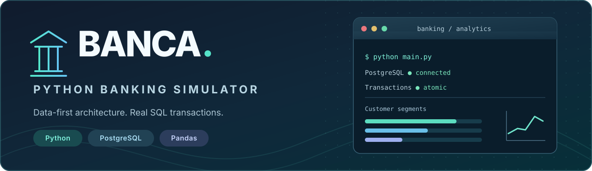

<div align="center">



# Banca Python

**A database-first banking management simulator, built as a modular Python terminal application.**

[](https://www.python.org/)
[](https://www.postgresql.org/)
[](https://pandas.pydata.org/)
[](https://github.com/ilmuratore/banca-python/actions/workflows/tests.yml)
[](LICENSE)

**[🇮🇹 Documentazione in italiano](LEGGIMI.md)** · [Architecture](docs/ARCHITECTURE.md) · [Demo datasets](docs/DATASETS.md)

</div>

## Overview

Banca Python is a command-line application that simulates everyday bank-branch workflows. It combines an object-oriented domain model, a controller/view separation, transactional PostgreSQL persistence, explicit CSV import/export and exploratory data analysis with Pandas.

Unlike a CSV-backed exercise, **PostgreSQL is the source of truth**. The application reads from the database on demand, and successful operations are persisted immediately. CSV files are used only when the user requests an import or export.

> [!NOTE]
> This is a portfolio and educational **simulation**, not banking software for production or real financial data. It does not provide customer authentication, regulatory controls or a real payment network.

## Features

| Area | What you can do |
| --- | --- |
| **Branches & staff** | Configure branches, manage employees and their roles, and manage ATMs. |
| **Customers & accounts** | Create and update customer records, open accounts and view account details. |
| **Transactions** | Deposit cash or checks, withdraw using a selected ATM and inspect transaction history. |
| **Financing & investments** | Submit loan/mortgage requests, approve or reject requests and register investments. |
| **PostgreSQL** | Automatically initialize a new schema, use SQL transactions and guard account balances against conflicting operations. |
| **CSV interoperability** | Manually import/export entities with validation, transactional import and explicit confirmation. |
| **Analytics** | Filter and aggregate data with Pandas, join tables, build pivot tables and generate charts. |

### Data visualization

The **Pandas** menu can export four kinds of PNG charts from PostgreSQL data:

- Customer count by segment (bar chart)
- Customer segment distribution (pie chart)
- Monthly transaction volume (line chart)
- Account balance distribution (histogram)

Charts are saved under `data/csv/<BRANCH_CODE>/grafici/` and are intentionally excluded from version control.

## Tech stack

**Python 3.11+** · **PostgreSQL** · **psycopg 3** · **Pandas** · **Matplotlib** · **unittest**

## Project structure

```text
banca-python/
├── assets/                  # README banner
├── controllers/             # Application use cases and validations
├── data/csv/FIL001/         # Versioned, synthetic demonstration data
├── docs/                    # Architecture, dataset guide, SQL checks
├── models/                  # Domain objects, enums, business exceptions
├── repository/              # PostgreSQL queries and transactions
├── scripts/                 # Synthetic dataset generator
├── services/                # CSV handling and Pandas analytics
├── tests/                   # Unit tests and SQL transaction simulations
├── views/                   # Interactive terminal menus
├── main.py                  # Application entry point
├── schema.sql               # Database initialization schema
└── requirements.txt
```

See [the architecture guide](docs/ARCHITECTURE.md) for the request flow and persistence rules.

## Quick start

### 1. Requirements

- Python 3.11 or newer
- A running PostgreSQL instance
- A database user permitted to create tables and sequences in the target database

### 2. Clone and install

```bash
git clone https://github.com/ilmuratore/banca-python.git
cd banca-python
python -m venv .venv
```

Activate the environment:

```powershell
# Windows PowerShell
.\.venv\Scripts\Activate.ps1
```

```bash
# Linux / macOS / Git Bash
source .venv/bin/activate
```

Then install dependencies:

```bash
python -m pip install -r requirements.txt
```

### 3. Create the PostgreSQL database

Connect with `psql`, pgAdmin or DBeaver and run:

```sql
CREATE DATABASE banca;
```

**Do not manually execute `schema.sql` for an empty database:** the application creates its tables and sequences at startup. It will stop if it detects a partially initialized schema, rather than silently deleting or rebuilding data.

### 4. Configure your connection

Environment variables control the connection:

| Variable | Default |
| --- | --- |
| `BANCA_DB_HOST` | `localhost` |
| `BANCA_DB_PORT` | `5432` |
| `BANCA_DB_NAME` | `banca` |
| `BANCA_DB_USER` | `postgres` |
| `BANCA_DB_PASSWORD` | `postgres` |

Set a password matching **your own local PostgreSQL setup** before launching the application:

```powershell
# Windows PowerShell
$env:BANCA_DB_PASSWORD="your-local-password"
python main.py
```

```bash
# Linux / macOS / Git Bash
export BANCA_DB_PASSWORD='your-local-password'
python main.py
```

The application reads **process environment variables directly**; it does not automatically load a `.env` file. Set `BANCA_NO_CLEAR=1` if you want the terminal to remain visible between menu actions.

### 5. Explore the application

Start by creating a branch, unless one already exists in the database. With a single branch, the application selects it automatically. Then create customers and accounts, register transactions, or load the synthetic demonstration dataset.

## Synthetic demo data

The repository includes **1,400 fictional rows** across seven CSV files, 200 per entity, in [`data/csv/FIL001/`](data/csv/FIL001/). They include staff, ATMs, customers, accounts, movements, financing and investments. No real personal or financial records are included.

1. Create or select the branch **`FIL001`** from the application (a branch cannot be created by CSV import).
2. Open **`8. Import / Export CSV` → `2. Importa CSV entità`**.
3. Import in this order: `dipendenti`, `atm`, `clienti`, `conti`, `movimenti`, `finanziamenti`, `investimenti`.
4. Approve each import explicitly, then explore the reporting and Pandas menus.

To generate a fresh dataset for a different branch:

```bash
python scripts/genera_dataset.py --filiale BR001 --record 200
```

For alternate ID ranges and important transaction/import caveats, read the [dataset guide](docs/DATASETS.md). **Use an isolated demonstration database and back up any existing data before import.**

## Testing

Run the database-free unit test suite:

```bash
python -m unittest discover -s tests -v
```

The tests exercise domain/controller behavior, CSV validation, SQL command construction and simulated transactions. **They do not replace an end-to-end test against a running PostgreSQL server.** A separate manual verification checklist and SQL checks are provided in [the architecture guide](docs/ARCHITECTURE.md) and [`docs/sql/VERIFICA_IMPORT.sql`](docs/sql/VERIFICA_IMPORT.sql).

GitHub Actions runs the unit tests on supported Python versions for commits and pull requests.

## Roadmap

This project is intentionally a terminal-based simulator. Possible future extensions include integration tests with disposable PostgreSQL instances, richer reporting and a web interface. These are **ideas**, not implemented features.

## License

Released under the [MIT License](LICENSE). Copyright © 2026 Simone Iengo.
