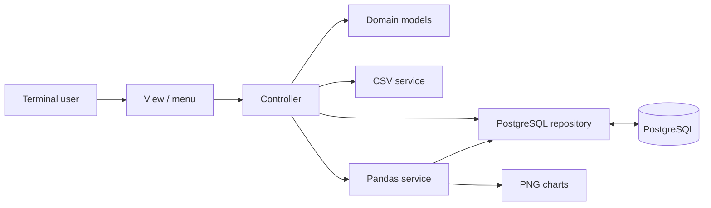

# Architecture and technical notes

Banca Python is a terminal application based on an **MVC-inspired separation**, a PostgreSQL repository and dedicated CSV/analytics services. PostgreSQL is the system of record: Python domain objects do not act as an independent persistent database.

## Components

| Path | Responsibility |
| --- | --- |
| `main.py` | Connect to PostgreSQL, initialize the schema, wire dependencies and start the menu. |
| `models/` | Business entities, abstract contracts, enumerations and exceptions. |
| `views/menu.py` | Input, display, navigation and terminal feedback. |
| `controllers/banca_controller.py` | Coordinate use cases, model validation and repository/service calls. |
| `repository/postgresql.py` | SQL queries, account synchronization, persistence and transaction boundaries. |
| `services/csv_service.py` | Explicit CSV export, strict column checks and typed import parsing. |
| `services/analisi_pandas.py` | Pandas analysis and PNG chart generation. |
| `schema.sql` | Tables, constraints, foreign keys and indexes used during first launch. |
| `scripts/genera_dataset.py` | Reproducible synthetic data generation. |
| `tests/` | Unit tests with simulated database interactions. |



## Application lifecycle

1. `main.py` opens a connection with `psycopg` using `BANCA_DB_*` environment variables.
2. The repository checks the application's tables in the active PostgreSQL schema.
3. If none exists, it applies the root `schema.sql` without dropping existing tables. If only some exist, startup fails rather than attempting unsafe partial repair.
4. The program reads branch information from PostgreSQL. One branch is selected automatically, while multiple branches require explicit selection.
5. User commands go from the view to the controller and repository. Database changes are persisted immediately; there is no in-memory "save" step.

## Data consistency

- Write operations are run inside `psycopg` transaction blocks. A successful unit of work commits; an error rolls back.
- Monetary operations rely on SQL and row locking (`SELECT ... FOR UPDATE`) instead of trusting an account balance cached in a Python object.
- The account balance is controlled by economic operations, not by importing the `saldo` CSV column.
- CSV imports are user-initiated and validated before persistence. A failed import is rolled back rather than partially accepted.
- Existing financial-operation IDs are not replayed as new movements during import.
- PostgreSQL constraints complement domain-level validation, including primary and foreign keys, field checks and uniqueness.

This is a simulation: it does **not** implement online banking authentication, permissions enforcement for individual signed-in users, audit-grade accounting, compliance or a real payments infrastructure.

## CSV and reporting

CSV files use **UTF-8 with BOM**, `;` as delimiter, `dd/mm/yyyy` for dates, `,` for decimals and `0`/`1` for booleans. The import workflow is described in [DATASETS.md](DATASETS.md).

Pandas obtains data from the repository and performs filters, aggregations, joins, pivots and time-series operations. Chart generation stores PNG files in `data/csv/<CODICE_FILIALE>/grafici/`.

## Tests and manual verification

Run unit tests without starting PostgreSQL:

```bash
python -m unittest discover -s tests -v
```

Suggested end-to-end checks with a **disposable PostgreSQL database**:

1. Start with an empty `banca` database; verify schema creation.
2. Create a branch, customer and account; verify they appear in PostgreSQL while the application is running.
3. Deposit funds; verify both the movement and balance.
4. Attempt a withdrawal larger than the available balance; verify no movement or balance change is committed.
5. Submit a loan, approve it once and ensure a second approval is rejected.
6. Export a CSV and re-import it; verify expected update/skip semantics and no duplicated economic operations.
7. Stop and restart the application; verify records persist.
8. Use [`sql/VERIFICA_IMPORT.sql`](sql/VERIFICA_IMPORT.sql) for read-only counts and reconciliation queries.

## Known boundaries

- PostgreSQL must be available for the interactive application to start.
- This project has unit tests, but no automated end-to-end PostgreSQL test environment is configured.
- The dataset is deliberately synthetic; entity counts per branch are not intended to model a real institution.
- The implementation targets a command-line interface, not an HTTP API or desktop GUI.
