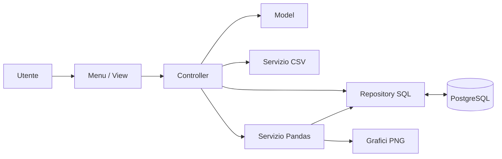

# Architettura e funzionamento

> **Lingua:** Italiano · [English](../ARCHITECTURE.md) · [Torna al LEGGIMI](../../LEGGIMI.md)

Banca Python è un'applicazione da terminale con separazione **ispirata al pattern MVC**, repository PostgreSQL e servizi CSV/Pandas. PostgreSQL è l'unico archivio persistente: i model Python non costituiscono un secondo database.

## Componenti

| Percorso | Responsabilità |
| --- | --- |
| `main.py` | Connessione, inizializzazione schema e avvio del menu |
| `models/` | Entità di dominio, contratti astratti, enum ed eccezioni |
| `views/menu.py` | Input, output, menu e navigazione |
| `controllers/banca_controller.py` | Coordinamento operazioni, validazione e servizi |
| `repository/postgresql.py` | Query SQL, persistenza e transazioni |
| `services/csv_service.py` | Import/export esplicito con controlli sui dati |
| `services/analisi_pandas.py` | Analisi Pandas e grafici PNG |
| `schema.sql` | Tabelle, vincoli, chiavi esterne e indici |
| `scripts/genera_dataset.py` | Generazione dati sintetici |
| `tests/` | Test automatici con database simulato |



## Ciclo di avvio

1. `main.py` legge le variabili `BANCA_DB_*` e apre la connessione tramite `psycopg`.
2. Il repository controlla le tabelle applicative nello schema PostgreSQL attivo.
3. Se non ne trova, applica `schema.sql` senza cancellare dati. Se trova uno schema parziale, interrompe l'avvio senza tentare riparazioni distruttive.
4. L'applicazione legge le filiali dal database. Ne seleziona automaticamente una soltanto se è l'unica presente.
5. Le operazioni attraversano view, controller e repository. Le modifiche vengono persistite direttamente, senza un comando di salvataggio separato.

## Coerenza e transazioni

- Le scritture utilizzano transazioni `psycopg`: successo = commit, errore = rollback.
- Le operazioni monetarie impiegano blocchi SQL `SELECT ... FOR UPDATE` per non basarsi su saldi Python potenzialmente non aggiornati.
- Il saldo viene modificato dalle operazioni finanziarie, non importando il campo `saldo` dei CSV.
- L'importazione CSV è manuale, validata e atomica.
- Le operazioni economiche già importate non vengono riapplicate se mantengono gli stessi ID.
- I vincoli PostgreSQL affiancano le validazioni dei model.

**Limite intenzionale:** il progetto non implementa autenticazione, autorizzazioni per utenti reali, contabilità certificata, infrastruttura di pagamento o conformità normativa.

## CSV e analisi

Il formato CSV usa `utf-8-sig`, separatore `;`, date `gg/mm/aaaa`, decimali con `,` e booleani `0`/`1`. Vedere [Dataset](DATASET.md).

Pandas legge dal repository e produce filtri, aggregazioni, merge, pivot e grafici in `data/csv/<CODICE_FILIALE>/grafici/`.

## Test e collaudo

```bash
python -m unittest discover -s tests -v
```

Per un collaudo manuale con database PostgreSQL **temporaneo**:

1. Avviare l'app su un database vuoto e verificare lo schema creato.
2. Creare filiale, cliente e conto; controllare i record con SQL.
3. Versare denaro e verificare saldo e movimento.
4. Provare un prelievo superiore al saldo; verificare che nessuna modifica venga registrata.
5. Approvare un finanziamento una sola volta; la seconda approvazione deve essere rifiutata.
6. Esportare e reimportare CSV controllando l'assenza di operazioni duplicate.
7. Riavviare l'applicazione per verificare la persistenza.
8. Eseguire le query di sola lettura in [`VERIFICA_IMPORT.sql`](../sql/VERIFICA_IMPORT.sql).

## Limiti conosciuti

- Il programma interattivo richiede PostgreSQL disponibile.
- Non esiste ancora una suite di test end-to-end automatizzata con PostgreSQL reale.
- I dati forniti sono artificiali e volutamente sovradimensionati.
- L'interfaccia è esclusivamente a terminale: non sono presenti API HTTP o interfacce web.
